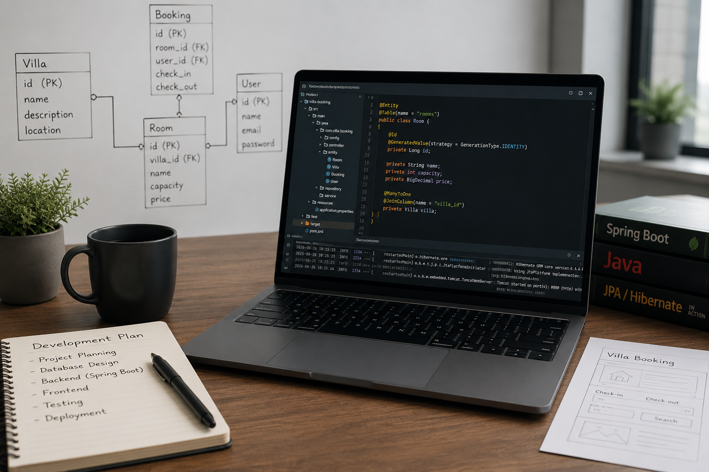

+++
title = "DevLog"
date = "2026-08-26"
draft = false
showInRecent = false
+++

## [Week 1 – Project Planning and User Stories](week1/)

## [Week 2 – Portfolio and Starting the Project](week2/)

## [Week 3 – Database Design and JPA](week3/)

## [Week 4 – Entities and Relationships](week4/)

## [Week 5 – DAO and CRUD Operations](week5/)

## [Week 6 – Service Layer and Business Logic](week6/)

## [Week 7 – User Authentication and Roles](week7/)

## [Week 8 – Room Management](week8/)

## [Week 9 – Booking Functionality](week9/)

## [Week 10 – Booking Validation and Availability](week10/)

## [Week 11 – Frontend and User Interface](week11/)

## [Week 12 – Integration and Testing](week12/)

## [Week 13 – Improvements and Bug Fixes](week13/)

## [Week 14 – Final Testing and Documentation](week14/)

## [Week 15 – Final Project and Reflection](week15/)

---

[← Back](/projects/project1/)