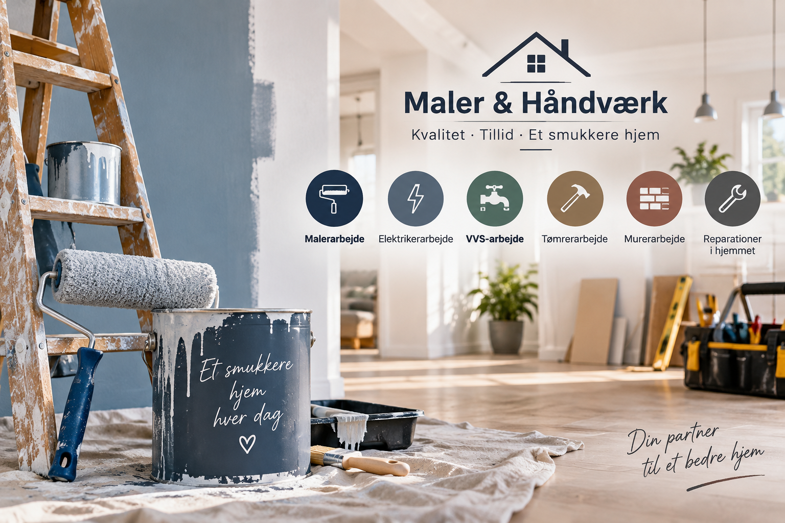

+++
title = "Maler & Håndværk"
date = "2026-01-04"
draft = false
hideChildPages = true
+++

<a href="/datamatiker-portfolio/projects/project3/devlog/"
style="border:1px solid #7c3aed !important; color:#c26d00 !important; border-radius:8px; padding:5px 12px; text-decoration:none !important;">
DevLog
</a>

<a href="/datamatiker-portfolio/projects/project3/report/"
style="border:1px solid #7c3aed !important; color:#c26d00 !important; border-radius:8px; padding:5px 12px; text-decoration:none !important;">
Report
</a>

## Project Description

A web application for a painting and home services company.

The main focus is painting services, with additional services such as electrical work, plumbing, carpentry, masonry, and general home repairs.

Customers can explore the available services and request help for different types of work in their homes.

## Services

- Malerarbejde
- Elektrikerarbejde
- VVS-arbejde
- Tømrerarbejde
- Murerarbejde
- Reparationer i hjemmet

## Technologies

- Java
- JPA / Hibernate
- PostgreSQL
- REST API
- HTML / CSS
- JavaScript

---

[← Back]()