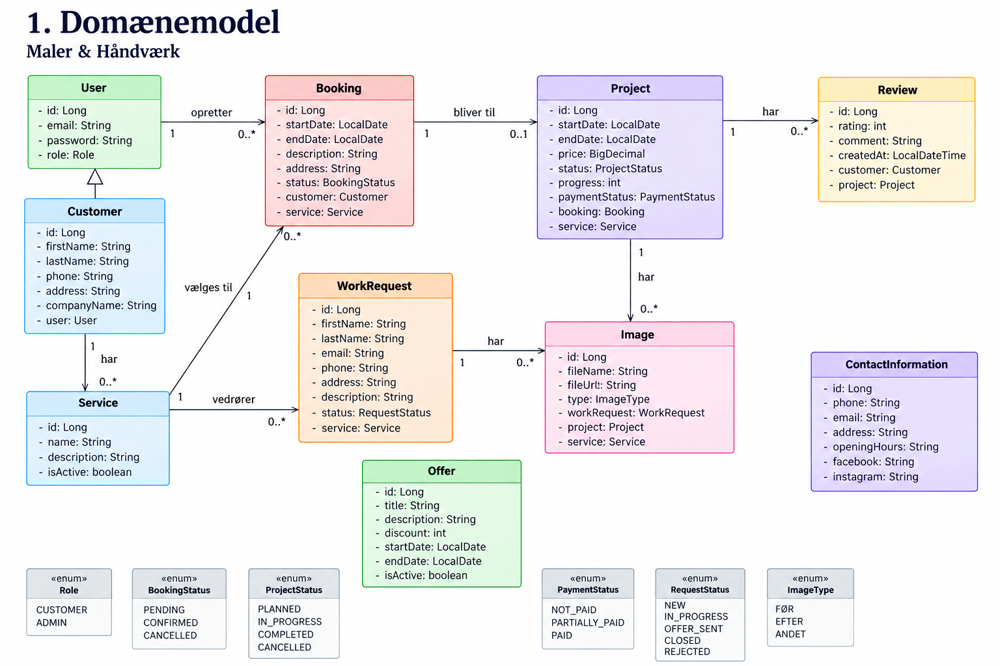
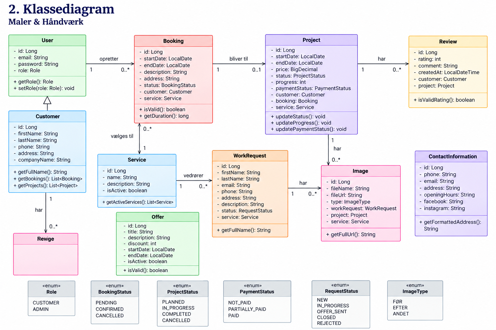
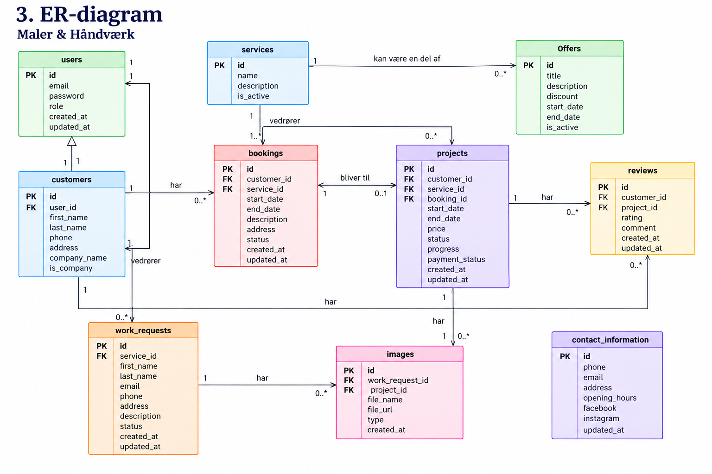
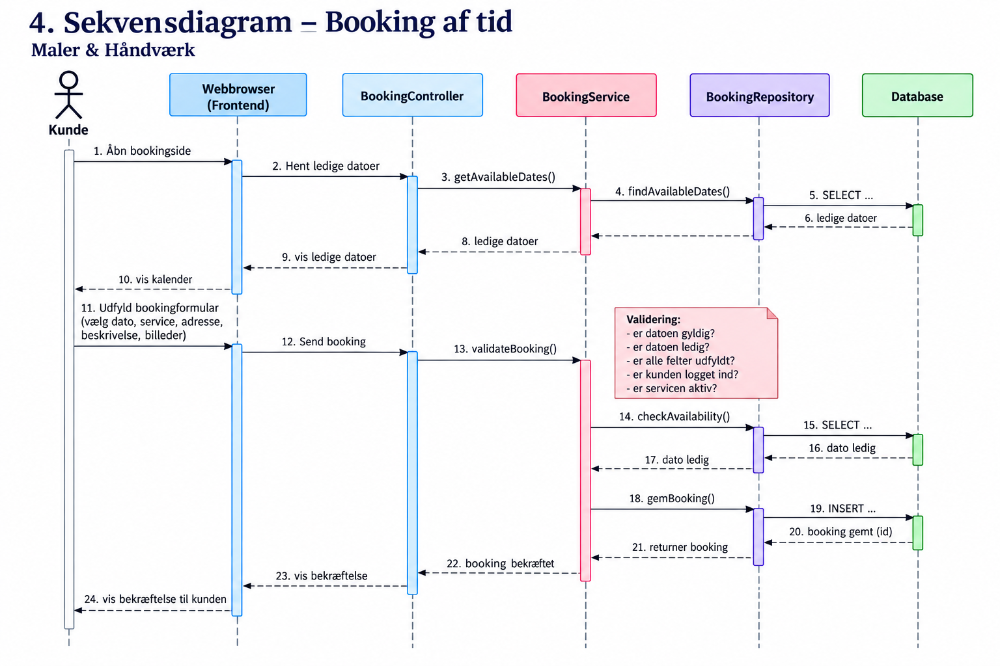
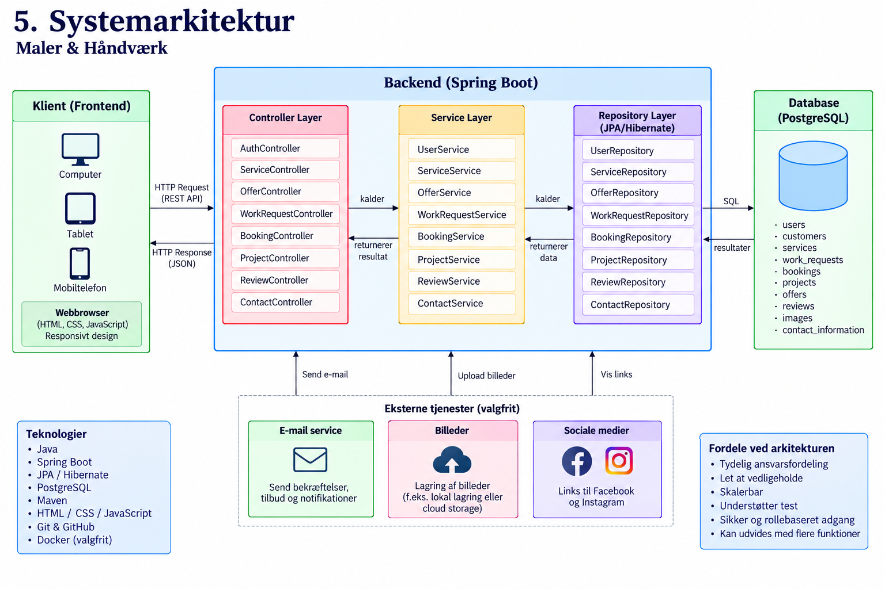
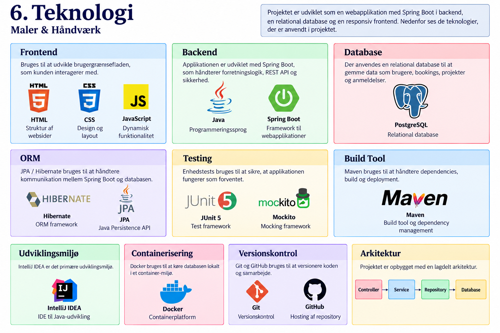

+++
title = "Project Report"
date = "2025-09-04"
draft = false

+++

# Maler & Håndværk

**Webapplikation til håndværksydelser og reparationer i hjemmet**

**3. semesterprojekt : Datamatiker**

- **Studerende:** Saniela Dhimitri
- **Uddannelse:** Datamatiker
- **Semester:** 3. semester
- **Uddannelsessted:** Erhvervsakademi København (EK)
- **Campus:** Lyngby
- **Teknologier:** Java · Spring Boot · JPA/Hibernate · PostgreSQL
- **Studieår:** 2026–2027

---

### Indhold

1. Indledning
2. Problemformulering
3. Brugerhistorier (User Stories)
4. Funktionelle krav
5. Ikke-funktionelle krav
6. Domænemodel
7. Klassediagram
8. ER-diagram
9. Sekvensdiagram
10. Systemarkitektur
11. Teknologier
12. Test
13. Konklusion

---

## 1. Indledning

Maler & Håndværk er en webapplikation til en virksomhed, der primært tilbyder malerarbejde, men også forskellige håndværksydelser såsom elektrikerarbejde, VVS-arbejde, tømrerarbejde, murerarbejde samt reparationer og vedligeholdelse i hjemmet.

Webapplikationen skal kunne anvendes af både besøgende, private kunder og virksomheder.

Besøgende skal kunne se virksomhedens ydelser, aktuelle tilbud og kampagner, kontaktoplysninger, anmeldelser samt FØR- og EFTER-billeder af tidligere udførte opgaver.

En besøgende uden en konto skal også kunne sende en forespørgsel på en opgave gennem en formular.

Registrerede kunder skal kunne logge ind, se ledige datoer og perioder og reservere en tid til en opgave. Kunden skal desuden kunne følge sit projekt, se start- og slutdato, pris, status, fremdrift og betaling.

Administrator skal kunne administrere hjemmesidens indhold, arbejdsforespørgsler, projekter og reservationer.

Applikationen udvikles i Java med Spring Boot og anvender JPA/Hibernate til databasekommunikation og PostgreSQL som relationel database.

---

## 2. Problemformulering

Håndværksvirksomheder modtager ofte henvendelser gennem flere forskellige kanaler såsom telefon, e-mail og sociale medier.

Dette kan gøre det vanskeligt at bevare et samlet overblik over arbejdsforespørgsler, kunder, reservationer, projekter, betalinger og igangværende arbejde.

Samtidig kan kunder have behov for hurtigt at kunne se virksomhedens ydelser, priser og tilbud, tidligere udførte opgaver samt ledige perioder.

Projektet tager derfor udgangspunkt i følgende problemformulering:

> **Hvordan kan der udvikles en brugervenlig webapplikation, hvor besøgende og kunder nemt kan finde håndværksydelser, sende arbejdsforespørgsler og booke arbejde, samtidig med at registrerede kunder kan følge deres projekter, og administratoren kan administrere virksomhedens hjemmeside, forespørgsler, projekter og reservationer?**

Systemet skal skabe en mere struktureret kommunikation mellem virksomheden og kunderne og samle de vigtigste funktioner ét sted.

---

# 3. Brugerhistorier (User Stories)

Brugerhistorierne beskriver webapplikationens vigtigste funktioner set fra besøgendes, kunders og administratorens perspektiv.

---

## US1 – Ydelser

**Som besøgende vil jeg kunne se alle de typer arbejde, virksomheden tilbyder, så jeg kan finde den ydelse, der passer til mit behov.**

Eksempler på ydelser:

- Malerarbejde
- Elektrikerarbejde
- VVS-arbejde
- Tømrerarbejde
- Murerarbejde
- Reparationer og vedligeholdelse

### Acceptance Criteria

- Alle aktive ydelser vises på hjemmesiden.
- Malerarbejde vises som virksomhedens primære ydelse.
- Hver ydelse har navn og beskrivelse.
- Besøgende kan åbne en ydelse og læse mere om den.

### Tasks

- Oprette Service entity.
- Implementere visning af ydelser.
- Hente aktive ydelser fra databasen.
- Udvikle en detaljeside for hver ydelse.

---

## US2 – Tidligere udførte opgaver

**Som besøgende vil jeg kunne se FØR- og EFTER-billeder af virksomhedens tidligere udførte opgaver, så jeg kan se eksempler på virksomhedens arbejde.**

### Acceptance Criteria

- Besøgende kan se FØR-billeder.
- Besøgende kan se EFTER-billeder.
- Billeder kan opdeles efter typen af arbejde.
- Hvert projekt kan have flere billeder.

### Tasks

- Implementere lagring af billeder.
- Knytte billeder til projekter eller ydelser.
- Udvikle en side til visning af tidligere arbejde.

---

## US3 – Tilbud og kampagner

**Som besøgende eller kunde vil jeg kunne se virksomhedens aktuelle tilbud og kampagner, så jeg kan se, om der findes en relevant rabat eller kampagne.**

Eksempel:

**Juletilbud**

20 % rabat på indvendig maling.

Gyldig fra 01.12 til 31.12.

### Acceptance Criteria

- Aktuelle tilbud vises på en separat side.
- Et tilbud kan have titel og beskrivelse.
- Et tilbud kan indeholde pris eller rabat.
- Startdato og slutdato vises.
- Udløbne tilbud vises ikke som aktive tilbud.

### Tasks

- Oprette Offer entity.
- Implementere start- og slutdato.
- Implementere visning af aktive tilbud.
- Udvikle tilbudssiden.

---

## US4 – Kontakt & sociale medier

**Som besøgende vil jeg kunne se virksomhedens kontaktoplysninger og sociale medier, så jeg nemt kan kontakte virksomheden.**

### Acceptance Criteria

Følgende information kan vises:

- Telefonnummer
- E-mail
- Adresse
- Åbningstider
- Facebook
- Instagram

### Tasks

- Udvikle kontaktside.
- Gemme virksomhedens kontaktoplysninger.
- Implementere links til sociale medier.

---

## US5 – Formular "Få et tilbud"

**Som besøgende uden en konto vil jeg kunne udfylde en formular om den ønskede opgave, så virksomheden kan kontakte mig og give mig et tilbud.**

### Acceptance Criteria

Besøgende kan angive:

- Fornavn
- Efternavn
- E-mail
- Telefonnummer
- Adresse
- Type af arbejde
- Beskrivelse
- Billeder

Forespørgslen gemmes i systemet og bliver tilgængelig for administratoren.

### Tasks

- Udvikle formularen.
- Implementere validering.
- Implementere upload af billeder.
- Gemme forespørgslen i databasen.
- Knytte forespørgslen til den valgte ydelse.

---

## US6 – Login efter rolle

**Som bruger vil jeg kunne logge ind i systemet, så jeg får adgang til de funktioner, der tilhører min rolle.**

Systemet har to roller:

- `CUSTOMER`
- `ADMIN`

### CUSTOMER

En kunde får adgang til:

- Booking
- Egne reservationer
- Egne projekter
- Projektstatus
- Betalingsinformation

### ADMIN

En administrator får adgang til:

- Administration af hjemmesiden
- Arbejdsforespørgsler
- Projekter
- Reservationer

### Acceptance Criteria

- Brugeren kan logge ind.
- Systemet identificerer brugerens rolle.
- CUSTOMER kan kun se sine egne oplysninger.
- ADMIN får adgang til administrationsfunktionerne.
- Brugeren kan logge ud.

### Tasks

- Oprette User entity.
- Oprette Role enum.
- Implementere login.
- Implementere adgangskontrol.
- Implementere logout.

---

## US7 – Booking af tid

**Som privatkunde eller virksomhed vil jeg kunne se ledige datoer eller perioder og booke en tid til det arbejde, jeg ønsker udført.**

Ved bookingen skal kunden også kunne beskrive den ønskede opgave.

### Acceptance Criteria

Kunden kan:

- Se ledige datoer.
- Se ledige perioder.
- Vælge en dato eller periode.
- Vælge typen af arbejde.
- Angive adressen.
- Skrive en beskrivelse af arbejdet.
- Tilføje billeder.
- Bekræfte bookingen.

### Tasks

- Implementere bookingkalender.
- Implementere kontrol af ledige datoer.
- Udvikle bookingformular.
- Gemme reservationen i databasen.
- Knytte reservationen til kunden.

---

## US8 – Mit projekt

**Som kunde vil jeg have en side, hvor jeg kan følge mit projekt og se de vigtigste oplysninger om arbejdet.**

### Acceptance Criteria

Kunden kan se:

- Projektets navn/type.
- Startdato.
- Slutdato.
- Pris.
- Status.
- Fremdrift.
- Betalingsstatus.
- Billeder fra projektet.

Kunden kan annullere sin reservation **senest én uge før projektets startdato**.

Hvis der er mindre end 7 dage til projektets start, kan kunden ikke selv annullere reservationen.

### Tasks

- Udvikle siden "Mit projekt".
- Hente kundens egne projekter.
- Implementere projektstatus.
- Implementere fremdrift.
- Implementere betalingsstatus.
- Implementere regel for annullering.
- Implementere visning af projektbilleder.

---

## US9 – Vurderinger og anmeldelser

**Som kunde eller besøgende vil jeg kunne se anmeldelser fra andre kunder, så jeg kan få et indtryk af virksomhedens arbejde.**

Efter en afsluttet opgave kan en kunde skrive sin egen anmeldelse.

### Acceptance Criteria

- Alle besøgende kan se anmeldelser.
- Kunden kan give 1–5 stjerner.
- Kunden kan skrive en kommentar.
- En anmeldelse kan oprettes efter afsluttet arbejde.
- Anmeldelsen knyttes til kunden og projektet.

### Tasks

- Oprette Review entity.
- Implementere reviewformular.
- Validere rating fra 1–5.
- Gemme anmeldelser i databasen.
- Implementere visning af anmeldelser.

---

## US10 – Administration af hjemmesiden

**Som administrator vil jeg kunne administrere hjemmesidens indhold, så virksomhedens information altid er opdateret.**

### Acceptance Criteria

Administrator kan:

- Oprette, ændre og fjerne ydelser.
- Ændre beskrivelser af ydelser.
- Aktivere og deaktivere ydelser.
- Tilføje og fjerne FØR/EFTER-billeder.
- Opdatere telefonnummer.
- Opdatere e-mail.
- Opdatere adresse.
- Opdatere åbningstider.
- Opdatere links til sociale medier.
- Administrere anmeldelser.
- Oprette, ændre og fjerne tilbud og kampagner.

### Tasks

- Udvikle administrationsside.
- Implementere CRUD for ydelser.
- Implementere administration af billeder.
- Implementere administration af kontaktoplysninger.
- Implementere administration af tilbud.
- Implementere administration af anmeldelser.

---

## US11 – Håndtering af arbejdsforespørgsler

**Som administrator vil jeg kunne modtage og administrere arbejdsforespørgsler fra personer uden en konto, så jeg kan vurdere opgaven og give dem et tilbud.**

### Acceptance Criteria

Administrator kan se:

- Navn.
- E-mail.
- Telefonnummer.
- Adresse.
- Type af arbejde.
- Beskrivelse.
- Billeder.

Administrator kan:

- Åbne en forespørgsel.
- Behandle forespørgslen.
- Give kunden et tilbud.
- Ændre forespørgslens status.
- Afvise forespørgslen.

### Tasks

- Implementere oversigt over forespørgsler.
- Implementere detaljevisning.
- Implementere status.
- Implementere mulighed for at oprette et tilbud.

---

## US12 – Administration af projekter & reservationer

**Som administrator vil jeg kunne administrere alle projekter og reservationer, så virksomheden har et samlet overblik over planlagte og igangværende opgaver.**

### Acceptance Criteria

Administrator kan:

- Se alle projekter.
- Se alle reservationer.
- Se hvilken kunde eller virksomhed projektet tilhører.
- Ændre startdato.
- Ændre slutdato.
- Ændre pris.
- Ændre projektets status.
- Opdatere projektets fremdrift.
- Opdatere betalingsstatus.
- Tilføje billeder til projektet.
- Ændre en reservation.
- Annullere en reservation.

### Tasks

- Implementere projektadministration.
- Implementere reservationsadministration.
- Implementere ændring af datoer.
- Implementere pris.
- Implementere projektstatus.
- Implementere fremdrift.
- Implementere betalingsstatus.
- Implementere projektbilleder.

---

# 4. Funktionelle krav

De funktionelle krav beskriver de funktioner, som Maler & Håndværk skal understøtte.

Systemet skal kunne:

- Vise virksomhedens ydelser.
- Vise detaljer om hver ydelse.
- Vise FØR- og EFTER-billeder.
- Vise aktuelle tilbud og kampagner.
- Vise virksomhedens kontaktoplysninger.
- Vise links til sociale medier.
- Modtage arbejdsforespørgsler fra besøgende uden konto.
- Modtage beskrivelser og billeder sammen med en forespørgsel.
- Oprette brugere.
- Understøtte rollerne CUSTOMER og ADMIN.
- Give brugere mulighed for login og logout.
- Vise ledige datoer og perioder.
- Give kunder mulighed for at foretage en booking.
- Gemme start- og slutdato for projekter.
- Give kunder adgang til deres egne projekter.
- Vise pris, status, fremdrift og betalingsstatus.
- Give kunden mulighed for at annullere senest 7 dage før start.
- Give kunder mulighed for at skrive anmeldelser.
- Give administratoren mulighed for at administrere hjemmesidens indhold.
- Administrere arbejdsforespørgsler.
- Administrere tilbud.
- Administrere projekter og reservationer.
- Administrere billeder.
- Administrere ydelser.
- Administrere kontaktoplysninger.
- Gemme relevante oplysninger i PostgreSQL-databasen.

---

# 5. Ikke-funktionelle krav

## Brugervenlighed

Webapplikationen skal have en enkel og overskuelig brugergrænseflade.

Besøgende skal hurtigt kunne finde virksomhedens ydelser, tilbud, tidligere arbejde og kontaktoplysninger.

Kunder skal nemt kunne booke en tid og følge deres projekter.

## Responsivt design

Webapplikationen skal kunne anvendes på:

- Computer
- Tablet
- Mobiltelefon

## Sikkerhed

Brugeroplysninger og adgangskoder skal håndteres sikkert.

Systemet skal anvende rollebaseret adgang.

En kunde må kun kunne se sine egne projekter og reservationer.

Administrationsfunktionerne må kun være tilgængelige for brugere med rollen `ADMIN`.

## Pålidelighed

Systemet skal sikre, at reservationer, projekter, arbejdsforespørgsler og betalinger gemmes korrekt.

Systemet skal forhindre, at den samme periode bliver reserveret flere gange, hvis den ikke er tilgængelig.

## Vedligeholdelse

Applikationen skal anvende en tydelig lagdelt arkitektur med:

**Controller → Service → Repository → Database**

Dette gør koden mere overskuelig og nemmere at vedligeholde.

## Validering

Systemet skal validere brugerinput såsom:

- Navn
- E-mail
- Telefonnummer
- Adresse
- Datoer
- Beskrivelse
- Rating

---

# 6. Domænemodel

Domænemodellen beskriver de vigtigste objekter i Maler & Håndværk-systemet.

De centrale domæneklasser kan være:

- User
- Customer
- Service
- WorkRequest
- Booking
- Project
- Offer
- Review
- Image
- ContactInformation
- Role

`User` bruges til login og rollebaseret adgang.

En `Customer` kan være en privatkunde eller en virksomhed.

En kunde kan have flere bookinger og projekter.

En `Service` repræsenterer en type håndværksydelse såsom malerarbejde, elektrikerarbejde eller VVS.

En `WorkRequest` repræsenterer en arbejdsforespørgsel fra en besøgende uden konto.

En `Booking` indeholder information om den ønskede dato eller periode.

Når en opgave bliver planlagt, kan den være knyttet til et `Project`.

Et projekt indeholder blandt andet startdato, slutdato, pris, status, fremdrift og betalingsstatus.

Et `Offer` repræsenterer virksomhedens aktuelle tilbud og kampagner.

En `Review` indeholder kundens rating og kommentar.

Billeder kan anvendes til både tidligere udførte opgaver, arbejdsforespørgsler og projekter.

### Domænemodel

---

# 7. Klassediagram

Klassediagrammet viser de Java-klasser, der anvendes til implementeringen af systemet.

De vigtigste klasser kan være:

- User
- Customer
- Service
- WorkRequest
- Booking
- Project
- Offer
- Review
- Image
- ContactInformation

Derudover anvendes enums såsom:

- Role
- ProjectStatus
- PaymentStatus

Relationerne mellem klasserne implementeres med JPA/Hibernate.

Eksempelvis kan en kunde have flere projekter, mens hvert projekt tilhører én kunde.

### Klassediagram

---

# 8. ER-diagram

ER-diagrammet viser strukturen i PostgreSQL-databasen.

De vigtigste tabeller kan være:

- users
- customers
- services
- work_requests
- bookings
- projects
- offers
- reviews
- images
- contact_information

Hver tabel har en Primary Key (PK).

Foreign Keys (FK) anvendes til at oprette relationer mellem tabellerne.

Et projekt kan eksempelvis være knyttet til en kunde, en booking og en bestemt ydelse.

### ER-diagram

---

# 9. Sekvensdiagram

Et vigtigt flow i systemet er booking af en håndværksopgave.

Processen kan foregå således:

1. Kunden logger ind.
2. Kunden åbner bookingsiden.
3. Systemet henter ledige datoer.
4. Kunden vælger en dato eller periode.
5. Kunden vælger typen af arbejde.
6. Kunden indtaster adressen.
7. Kunden beskriver opgaven.
8. Kunden tilføjer eventuelt billeder.
9. Kunden sender bookingen.
10. Systemet validerer oplysningerne.
11. Systemet kontrollerer, om perioden stadig er ledig.
12. Bookingen gemmes i databasen.
13. Kunden modtager en bekræftelse.
14. Administratoren kan efterfølgende administrere reservationen.

Sekvensdiagrammet viser kommunikationen mellem brugergrænsefladen, Controller, Service, Repository og databasen.

### Sekvensdiagram

---

# 10. Systemarkitektur

Maler & Håndværk udvikles med en lagdelt arkitektur.

Systemets overordnede struktur er:

**Browser → Controller → Service → Repository → PostgreSQL**

## Controller

Controller-laget modtager HTTP-requests fra frontend og sender dem videre til Service-laget.

Controlleren håndterer eksempelvis requests omkring:

- Ydelser
- Booking
- Projekter
- Arbejdsforespørgsler
- Tilbud
- Reviews

## Service

Service-laget indeholder systemets forretningslogik.

Her håndteres blandt andet:

- Validering
- Login og roller
- Kontrol af ledige datoer
- Booking
- 7-dages-reglen for annullering
- Projektstatus
- Fremdrift
- Betalingsstatus
- Arbejdsforespørgsler
- Reviews

## Repository

Repository-laget kommunikerer med databasen.

Det bruges til at:

- Gemme data
- Hente data
- Opdatere data
- Slette data

## Database

PostgreSQL anvendes som relationel database til systemets data.

### Systemarkitektur

---

# 11. Teknologier

## Java

Java anvendes som det primære programmeringssprog til backend og forretningslogik.

## Spring Boot

Spring Boot anvendes til at udvikle webapplikationen og REST API'et.

## JPA / Hibernate

JPA og Hibernate anvendes til Object-Relational Mapping (ORM) mellem Java-klasser og PostgreSQL-tabeller.

## PostgreSQL

PostgreSQL anvendes som relationel database.

## Maven

Maven anvendes til dependency management og projektets biblioteker.

## Git og GitHub

Git anvendes til versionsstyring.

GitHub anvendes til at gemme projektets repository og følge ændringer i kildekoden.

## Docker

Docker kan anvendes til at køre PostgreSQL i et isoleret udviklingsmiljø.

## IntelliJ IDEA

IntelliJ IDEA anvendes til programmering, test og udvikling af backend.

## HTML / CSS / JavaScript

HTML, CSS og JavaScript anvendes til udvikling af brugergrænsefladen.

### Technology Stack

---

# 12. Test

Test anvendes til at kontrollere, at systemets funktioner fungerer korrekt.

Der anvendes både Unit Tests og Integration Tests.

## Unit Tests

JUnit 5 kan anvendes til Unit Tests.

Mockito kan anvendes til at teste Service-laget uden at være afhængig af den rigtige database.

Der kan blandt andet testes:

- Validering af e-mail.
- Validering af telefonnummer.
- Validering af arbejdsforespørgsler.
- Kontrol af ledige datoer.
- Booking af en ledig periode.
- Kontrol af start- og slutdato.
- Beregning af 7-dages-reglen for annullering.
- Ændring af projektstatus.
- Ændring af betalingsstatus.
- Validering af rating fra 1–5.
- Kontrol af brugerroller.

## Integration Tests

Integration Tests anvendes til at kontrollere samspillet mellem applikationen og databasen.

Der kan blandt andet testes:

- Oprettelse af bruger.
- Oprettelse af kunde.
- Oprettelse af ydelse.
- Oprettelse af arbejdsforespørgsel.
- Oprettelse af booking.
- Oprettelse af projekt.
- Oprettelse af tilbud.
- Oprettelse af anmeldelse.
- Hentning af kundens projekter.
- Opdatering af projekt.
- Opdatering af reservation.
- Relationer mellem entities.
- Lagring og hentning af data fra PostgreSQL.

## Test af booking

Booking er et af systemets vigtigste områder.

Systemet skal kontrollere:

1. At kunden er logget ind.
2. At den valgte ydelse eksisterer.
3. At start- og slutdato er gyldige.
4. At den valgte dato eller periode er ledig.
5. At de nødvendige oplysninger er udfyldt.
6. At bookingen gemmes korrekt.

## Test af annullering

Systemet skal kontrollere forskellen mellem den aktuelle dato og projektets startdato.

Hvis der er mindst 7 dage til startdatoen, kan kunden annullere reservationen.

Hvis der er mindre end 7 dage til startdatoen, skal systemet afvise kundens forsøg på selv at annullere reservationen.

---

# 13. Konklusion

Maler & Håndværk er en webapplikation, der samler virksomhedens håndværksydelser, kundehenvendelser, reservationer og projekter i ét system.

Virksomhedens primære arbejdsområde er malerarbejde, men systemet understøtter også elektrikerarbejde, VVS-arbejde, tømrerarbejde, murerarbejde samt reparationer og vedligeholdelse.

Besøgende kan se virksomhedens ydelser, tilbud, kontaktoplysninger, anmeldelser og FØR/EFTER-billeder samt sende en arbejdsforespørgsel uden at oprette en konto.

Registrerede kunder kan logge ind, se ledige datoer, booke en opgave og følge deres projekter. Kunden kan se startdato, slutdato, pris, status, fremdrift og betalingsstatus samt annullere en reservation senest én uge før projektets start.

Administrator har mulighed for at administrere hjemmesidens indhold, arbejdsforespørgsler, tilbud, projekter og reservationer.

Systemet anvender rollebaseret adgang med rollerne CUSTOMER og ADMIN.

Projektet udvikles med Java, Spring Boot, JPA/Hibernate og PostgreSQL og anvender en lagdelt arkitektur med Controller, Service og Repository.

Projektet giver dermed praktisk erfaring med udvikling af en komplet webapplikation, herunder systemdesign, databasedesign, login og roller, REST API, booking, projektadministration, JPA/Hibernate, test og frontend-udvikling.

---

[← Back](/projects/project3/)