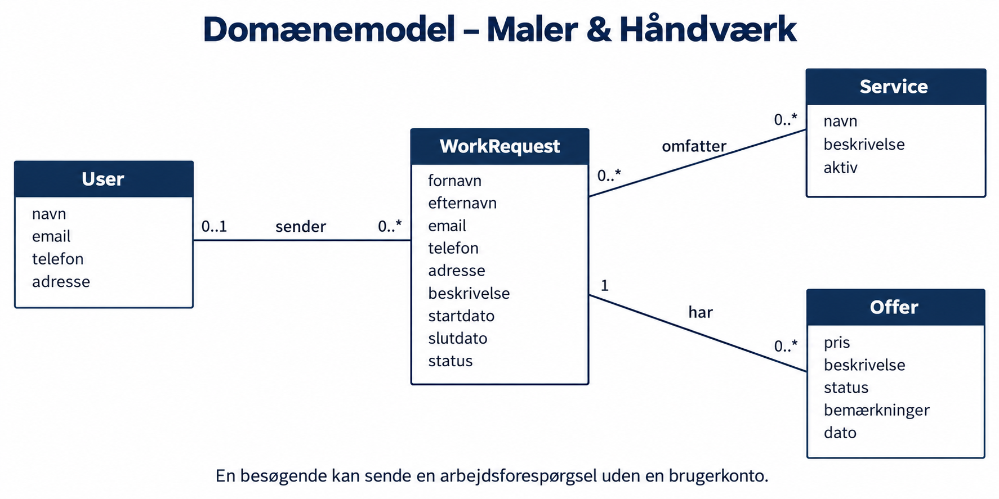
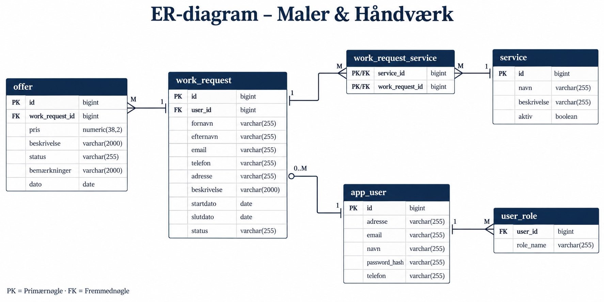
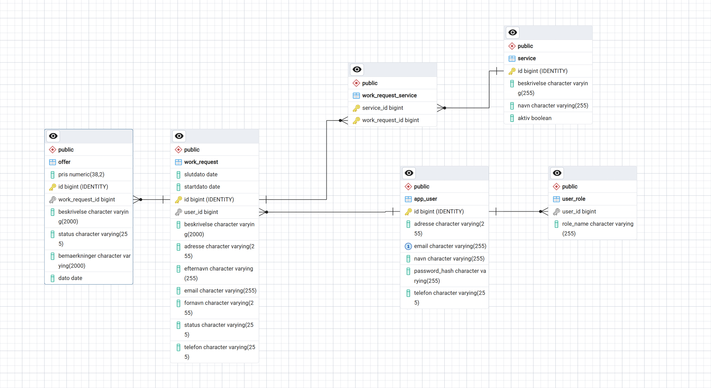
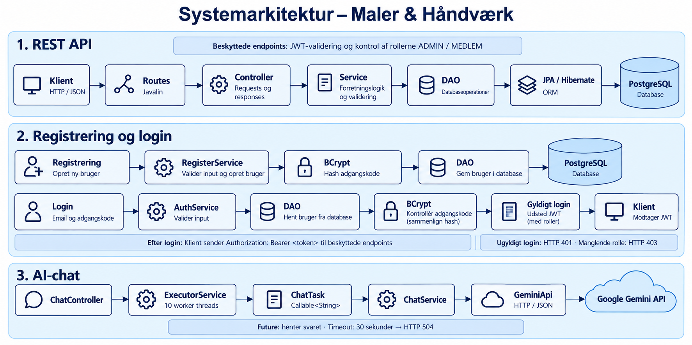
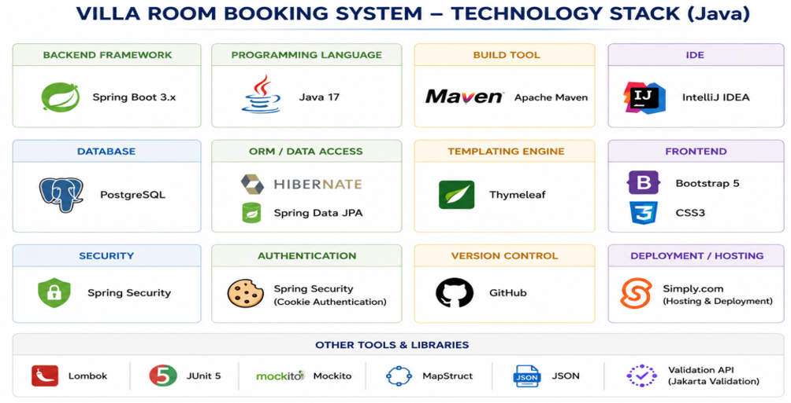

+++
title = "Project Report"
date = "2026-09-04"
draft = false

+++

# Maler & Håndværk

**REST API til håndværksydelser og arbejdsforespørgslerREST API til håndværksydelser og arbejdsforespørgsler**

**3. semesterprojekt : Datamatiker**

- **Studerende:** Saniela Dhimitri
- **Uddannelse:** Datamatiker
- **Semester:** 3. semester
- **Uddannelsessted:** Erhvervsakademi København (EK)
- **Campus:** Lyngby
- **Teknologier:** Java · Javalin · JPA/Hibernate · PostgreSQL
- **Studieår:** 2026–2027

---

### Indhold

1. Indledning
2. Problemformulering
3. Brugerhistorier (User Stories)
4. Domænemodel
5. ER-diagram 
6. Systemarkitektur 
7. Teknologier
8. Test 
9. Konklusion

---

## 1. Indledning

Maler & Håndværk er mit backendprojekt på 3. semester af datamatikeruddannelsen på Erhvervsakademi København.

Formålet er at udvikle et REST API til håndtering af arbejdsforespørgsler, ydelser og tilbud.

I løbet af 11 uger har jeg arbejdet med Java, Javalin, PostgreSQL, JPA/Hibernate, REST API, test, JWT, concurrency, Gemini AI og DevOps.

Projektet har givet mig praktisk erfaring med backendudvikling og en bedre forståelse af, hvordan de forskellige teknologier arbejder sammen.

---

## 2. Problemformulering

Hvordan kan jeg udvikle et REST API i backend, med Java og Javalin, der gør det muligt at håndtere arbejdsforespørgsler, ydelser og tilbud i en håndværksvirksomhed?

Hvordan kan jeg samtidig bruge PostgreSQL, JPA/Hibernate, sikkerhed, automatiserede tests og andre backendteknologier til at skabe en struktureret og sikker applikation?

---

## 3. User Stories

### US1 – Se håndværksydelser

**Som besøgende vil jeg kunne se virksomhedens ydelser, så jeg kan finde den service, jeg har brug for.**

**Acceptance Criteria**
- Besøgende kan se alle tilgængelige ydelser.
- Hver ydelse har et navn og en beskrivelse.
- Ydelserne hentes fra databasen.

**Tasks**
- Oprette `Service` Entity.
- Implementere `ServiceDAO`.
- Oprette GET-endpoint.
- Teste endpointet med REST Assured.

---

### US2 – Oprette arbejdsforespørgsel

**Som besøgende vil jeg kunne sende en arbejdsforespørgsel uden at logge ind, så virksomheden kan kontakte mig.**

**Acceptance Criteria**
- Besøgende kan sende en forespørgsel uden login.
- Forespørgslen indeholder kontaktoplysninger og beskrivelse.
- Forespørgslen gemmes i databasen.
- API'et returnerer `201 Created` ved succes.

**Tasks**
- Oprette `WorkRequest` Entity og DTO.
- Implementere POST-endpoint.
- Gemme data med JPA/Hibernate.
- Teste oprettelse med REST Assured.

---

### US3 – Se arbejdsforespørgsler

**Som administrator vil jeg kunne se alle arbejdsforespørgsler, så jeg kan få et overblik over kundernes opgaver.**

**Acceptance Criteria**
- Administrator kan hente alle arbejdsforespørgsler.
- Administrator kan hente en forespørgsel via ID.
- API'et returnerer `404 Not Found`, hvis ID'et ikke findes.

**Tasks**
- Implementere `WorkRequestDAO`.
- Oprette GET-endpoints.
- Implementere Controller og Service.
- Teste GET-endpoints.

---

### US4 – Opdatere arbejdsforespørgsel

**Som administrator vil jeg kunne ændre status på en arbejdsforespørgsel, så jeg kan følge behandlingen af opgaven.**

**Acceptance Criteria**
- Administrator kan ændre status.
- Status kan eksempelvis være `AFVENTER`, `GODKENDT` eller `AFVIST`.
- Ændringer gemmes i PostgreSQL.
- Kun autoriserede brugere kan udføre beskyttede ændringer.

**Tasks**
- Oprette `WorkRequestStatus` Enum.
- Implementere opdateringsmetode i DAO.
- Oprette PATCH- eller PUT-endpoint.
- Teste statusændringer.

---

### US5 – Oprette tilbud

**Som administrator vil jeg kunne oprette et tilbud til en arbejdsforespørgsel, så kunden kan få information om opgavens pris og indhold.**

**Acceptance Criteria**
- Et tilbud kan oprettes til en eksisterende arbejdsforespørgsel.
- Tilbuddet indeholder relevante oplysninger.
- Tilbuddet gemmes i databasen.
- En arbejdsforespørgsel kan have flere tilbud.

**Tasks**
- Oprette `Offer` Entity og DTO.
- Implementere relationen til `WorkRequest`.
- Oprette DAO, Service og Controller.
- Implementere POST-endpoint.
- Teste oprettelse af tilbud.

---

### US6 – Registrere bruger

**Som ny bruger vil jeg kunne oprette en konto, så jeg kan få adgang til systemets brugerfunktioner.**

**Acceptance Criteria**
- Brugeren kan registrere sig med nødvendige oplysninger.
- Brugernavnet eller e-mailen skal være unik.
- Adgangskoden hashes med BCrypt.
- Brugeren gemmes i databasen.

**Tasks**
- Oprette `User` Entity.
- Oprette `RegisterDTO`.
- Implementere `RegisterService`.
- Implementere registreringsendpoint.
- Teste brugerregistrering.

---

### US7 – Login med JWT

**Som registreret bruger vil jeg kunne logge ind sikkert, så jeg kan få adgang til beskyttede funktioner.**

**Acceptance Criteria**
- Brugeren kan logge ind med gyldige oplysninger.
- Forkerte loginoplysninger afvises.
- Systemet udsteder et JWT-token ved succesfuldt login.
- Beskyttede endpoints kræver et gyldigt token.

**Tasks**
- Implementere login i Controller og Service.
- Verificere adgangskoder med BCrypt.
- Implementere JWT-generering og validering.
- Teste login og ugyldige tokens.

---

### US8 – Rollebaseret adgang

**Som administrator vil jeg have adgang til administrationsfunktioner, så almindelige brugere ikke kan ændre virksomhedens data uden tilladelse.**

**Acceptance Criteria**
- Systemet understøtter rollerne `ADMIN` og `MEDLEM`.
- Administrator kan tilgå beskyttede administrationsfunktioner.
- Brugere uden den nødvendige rolle får `403 Forbidden`.
- Brugere uden gyldig authentication får `401 Unauthorized`.

**Tasks**
- Implementere roller.
- Tilføje authorization til beskyttede endpoints.
- Kontrollere JWT og brugerrolle.
- Teste adgang med forskellige roller.

---

### US9 – AI-chat med Gemini

**Som besøgende vil jeg kunne stille spørgsmål til en AI-chat, så jeg kan få hjælp til generelle spørgsmål om malerarbejde og håndværksydelser.**

**Acceptance Criteria**
- Brugeren kan sende en besked til chat-endpointet.
- Backend sender forespørgslen til Gemini API.
- Brugeren modtager et svar fra AI-servicen.
- Fejl fra den eksterne API håndteres.
- API-nøglen opbevares uden for kildekoden.

**Tasks**
- Oprette `ChatController`.
- Implementere `ChatService`.
- Oprette DTO'er til chat.
- Integrere Gemini API.
- Teste ChatService med Mockito.

---

### US10 – Automatisk test og build

**Som udvikler vil jeg kunne teste og bygge applikationen automatisk, så jeg lettere kan opdage fejl og sikre en stabil udviklingsproces.**

**Acceptance Criteria**
- Projektet kan bygges med Maven.
- Unit tests kan køres med JUnit.
- REST API kan testes med REST Assured.
- Databasetests kan anvende Testcontainers.
- GitHub Actions starter et build ved push eller pull request.

**Tasks**
- Oprette JUnit-tests.
- Implementere REST Assured-tests.
- Konfigurere Testcontainers med PostgreSQL.
- Konfigurere Docker.
- Oprette GitHub Actions-workflow.
- Kontrollere Maven-build.

**Bemærkning:** GitHub Actions-workflowet anvender `-DskipTests`, så det automatiske build kører uden at udføre testene.

---

## 4. Domænemodel

Domænemodellen viser de vigtigste objekter i **Maler & Håndværk**:

- **User** – En bruger med loginoplysninger og roller.
- **Service** – En håndværksydelse, som virksomheden tilbyder.
- **WorkRequest** – En arbejdsforespørgsel med oplysninger om kundens opgave.
- **Offer** – Et tilbud med pris og status, der er knyttet til en arbejdsforespørgsel.

En bruger kan have flere arbejdsforespørgsler. Besøgende kan også sende en forespørgsel uden en konto. En arbejdsforespørgsel kan indeholde flere ydelser og have flere tilbud.

---

## 5. ER-diagram

ER-diagrammet viser tabellerne og deres relationer i PostgreSQL.

De centrale tabeller er:

users

services

work_requests

offers

Hver tabel har en primærnøgle (PK), som identificerer den enkelte række. Fremmednøgler (FK) forbinder tabellerne.

Relationerne er:

User → WorkRequest: En bruger kan have flere arbejdsforespørgsler.

WorkRequest → Offer: En arbejdsforespørgsel kan have flere tilbud.

WorkRequest ↔ Service: En arbejdsforespørgsel kan indeholde flere ydelser, og en ydelse kan indgå i flere forespørgsler. Denne relation gemmes i en forbindelsestabel.

Brugernes roller gemmes i en separat tabel via @ElementCollection.

ER-Diagram fra PostgreSQL

---

# 6. Systemarkitektur

**Maler & Håndværk** bruger en lagdelt arkitektur med Java og Javalin:

**Klient → Routes → Controller → Service → DAO → PostgreSQL**

## Routes og Controller

Routes definerer API’ets endpoints. Controller-laget modtager HTTP-requests og returnerer JSON-svar om ydelser, arbejdsforespørgsler, tilbud og brugere.

## Service

Service-laget håndterer forretningslogik, validering, registrering og login. JWT bruges til authentication og rollebaseret adgang.

## DAO og Database

DAO-laget bruger JPA/Hibernate til at oprette, hente, opdatere og slette data i PostgreSQL.

## AI-chatbot

Chatbotten følger dette flow:

**ChatController → ChatService → GeminiApi → Google Gemini API**

ExecutorService bruges til at håndtere flere chatopgaver samtidigt.

---
## 7. Teknologier

- **Java 25 og Javalin** – Backend og REST API.
- **Maven** – Dependencies og build.
- **JPA/Hibernate og PostgreSQL** – Databasehåndtering.
- **JWT og BCrypt** – Login og adgangskontrol.
- **Jackson og Java HttpClient** – JSON og kommunikation med eksterne API’er.
- **Google Gemini API** – AI-chatbot.
- **ExecutorService, Callable og Future** – Samtidige chatopgaver.
- **JUnit, Mockito, REST Assured og Hamcrest** – Test.
- **Docker og Testcontainers** – Testdatabase.
- **SLF4J og Logback** – Logging.
- **Git og GitHub** – Versionsstyring.
- 
  
---
## 8. Test

I projektet **Maler & Håndværk** har jeg arbejdet med forskellige tests for at kontrollere REST API’et, databasen, forretningslogikken og chatbotten.

### DAO-tests

DAO-testene kontrollerer, at data bliver gemt og hentet korrekt fra databasen. Jeg tester oprettelse, hentning, opdatering og sletning af data.

Testene bruger en separat PostgreSQL-testdatabase, **maler_test**, som oprettes med Testcontainers. Hibernate anvender `create-drop` til at oprette og fjerne tabeller under testforløbet.

### Service-tests

Service-testene kontrollerer forretningslogikken med **JUnit og Mockito**. Mockito bruges til at erstatte afhængigheder med mocks, så logikken kan testes isoleret.

Jeg tester blandt andet:

- Login og brugerregistrering.
- Validering af oplysninger.
- Håndtering af ydelser.
- Arbejdsforespørgsler og tilbud.

### API-tests

API-testene bruger **REST Assured og Hamcrest** til at kontrollere HTTP-endpoints, statuskoder og JSON-svar.

De tests, der bruger den manuelt startede server, kræver, at applikationen kører på port **7070**, og at de nødvendige testdata er oprettet.

### Chatbot-tests

Chatbot-testene kontrollerer integrationen med Google Gemini samt håndtering af samtidige forespørgsler og timeout.

- **ChatBusinessPromptTest:** Tester chatbot-svar via Gemini API.
- **ChatConcurrencyTest:** Tester fem samtidige HTTP-requests med Mockito.
- **ChatControllerTest:** Tester, at serveren returnerer `504 Gateway Timeout`, når Gemini-svaret tager for lang tid.
- **ChatTimeoutTest:** Tester timeout med `Future`.

Tests med rigtige Gemini-kald kræver, at `GEMINI_API_KEY` er konfigureret.

### Testresultat

Den dokumenterede Maven-testkørsel fra **17. oktober 2026** viser:

- **150 tests kørt.**
- **0 fejl og 0 fejlede tests.**
- **0 tests sprunget over.**
- **BUILD SUCCESS.**

Testene hjælper med at opdage fejl og kontrollere, 
at de testede funktioner virker som forventet.
---

# 9. Konklusion

I **Maler & Håndværk** har jeg udviklet et REST API i backend 
til håndtering af ydelser, arbejdsforespørgsler og tilbud. 
Jeg har arbejdet med database, login, adgangskontrol og en AI-chatbot.

Projektet har styrket mine færdigheder i backendudvikling og test. 
Alle 150 tests i den dokumenterede testkørsel blev gennemført uden fejl.
---

[← Back](/projects/project3/)